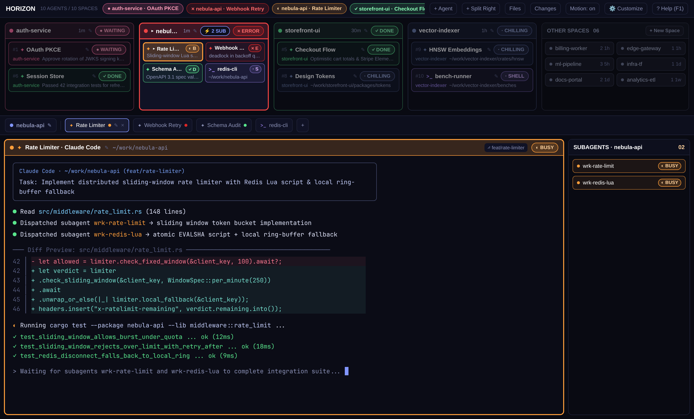

# Horizon (`horizon`)

Look out across the horizon of your entire [Herdr](https://herdr.dev) workspace and see immediately what needs your attention first.

Built to be a genuinely functional, everyday command deck rather than a novelty skin, **Horizon** keeps all of your spaces, agents, and subagents neat, tidy, and ordered across the top of your screen so you never lose track of parallel work.

## Why Horizon?

- **Instant Visual Priority Across the Horizon:** Spaces and agents automatically sort left-to-right by what needs you right now—anything waiting on your input (`● WAITING`) or throwing an error (`✕ ERROR`) surfaces on the far left, followed by active work (`◐ BUSY`), newly finished turns (`✓ DONE`), and idle spaces (`· CHILLING`), ordered within each tier by how recently you touched them.
- **Unmistakable 6-State Color Coding:** Every status has its own distinct color family—**Waiting** (Rose Pink), **Error** (Crimson Red), **Busy** (Warm Amber), **Done** (Emerald Green), **Chilling** (Cool Slate), and **Shell** (Soft Lilac)—with brighter borders and fills on the currently focused card and terminal pane so your eye knows exactly where you are.
- **Neat, Adaptive Space Boxes:** Spaces with 1–2 agents render full-width two-line cards (with marquee text that only scrolls on the active or hovered card so the screen stays calm); spaces with 3+ agents automatically pack into a clean **2×3 compact grid** with pagination, while quieter spaces tuck into the recessed **`OTHER SPACES`** box on the right.
- **Live Subagent Tracking & Pop-Out Peek:** When an agent spawns background subagents, a `⚡ SUB` badge lights up on its space box and an auto-hiding **`SUBAGENTS`** rail appears beside your terminal—click any subagent to pop out and peek at its live terminal output, and the rail tucks itself away as soon as they finish.
- **Built-In `⚙ Customize` & `? Help (F1)` Overlays:** Press `Ctrl+Shift+,` or click `⚙ Customize` for a pop-out settings overlay to tune deck height, expanded space count, grid rows/columns, and cross-platform window dragging/titlebar options (`Auto` on Windows/macOS). Press `F1` (`Ctrl+/`) to toggle the shortcut & status guide overlay, and hit `Escape` (or `F1` again) to dismiss.

## Install in Herdr

Paste this prompt into any agent running inside Herdr:

> Install `https://github.com/vincerhodes/horizon` following `~/.config/herdr-app/AGENTS.md`.

Or see [RECIPE.md](RECIPE.md) for the full layout specification and manual install steps.
