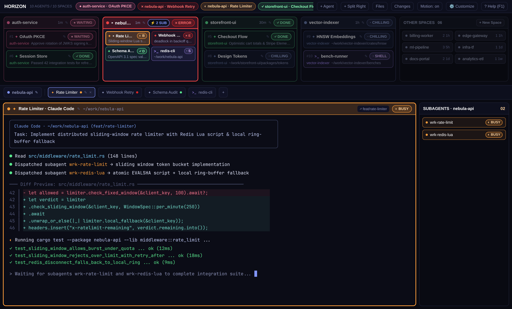

# Horizon

Look out across the horizon of your entire Herdr workspace and see immediately what to prioritize first. Designed as a clean, tidy, and deeply functional daily-driver command deck, **Horizon** orders your spaces left-to-right by live urgency (`● WAITING` > `✕ ERROR` > `◐ BUSY` > `✓ DONE` > `· CHILLING` > `· SHELL`) and recency, packs multi-agent spaces into adaptive grids, tucks quieter spaces into a recessed `OTHER SPACES` box on the right, and frames your active terminal below with a status-reactive border and an auto-hiding `SUBAGENTS` rail with click-to-peek pop-outs.

## What you see

1. **Top Horizon Deck (`#deck`, default `235px` height, `min: 220px`, resizable `175px`–`360px`):**
   - **Deck Header Bar (`#deck-header`, `36px` tall, `#0d0f1d` chrome background, `1px` `#1f2238` bottom border):**
     - Left: `HORIZON` (`13px` bold `#ffffff`) and live `N AGENTS / M SPACES` counter (`10px` `#565c7e`).
     - Center: horizontally scrollable hot-status pill strip (`22px` tall rounded pills) showing every non-idle agent across all spaces (`Space · Agent`, sorted by urgency) so any attention-needing agent can be focused in one click.
     - Right: `24px` action buttons (`+ Agent`, `+ Split Right`, `Files`, `Changes`, `Motion: on/off`, `⚙ Customize`, and `? Help (F1)`), plus native window controls when the platform requires them (`"titlebar": "none"`).
     - **Cross-Platform Window Dragging (`"window_drag": true` on `#deck`):** On Windows and macOS (`windowDrag: "auto"`, or `"on"` on any platform), dragging the `#deck-header` bar moves the frameless window and double-clicking maximizes/restores it, while `#deck-body` and all interactive buttons stop mouse-down propagation so clicking cards never drags the window.
   - **Pop-Out Modal Dialog Overlays (`openOverlay` with `kind: "dialog"`, toggled by shortcut or dismissed via `Escape` / `✕ Close`):**
     - **`⚙ Customize` Overlay (`role: "customize-overlay"`, `620×470`, `Ctrl+Shift+,`):** Full pop-out configuration dialog with live controls for **Window Drag** (`Auto (Win/Mac)` / `On` / `Off`), **Window Titlebar** (`Frameless` / `System`), **Deck Height** (`− / 235px / +` and `S` `195px` / `M` `235px` / `L` `285px`), **Expanded Spaces** (`2`–`6`, default `4`), **Full-Width Agent Cards** (`≤ 0`–`4`, default `2`), **Compact Agent Grid** (`1 Col`/`2 Cols` × `2`–`5 rows`, default `2×3`), **Other Spaces Grid** (`1`–`3 cols` × `2`–`6 rows`, default `2×4`), and `↺ Reset to Defaults`.
     - **`? Help (F1)` Overlay (`role: "help-overlay"`, `680×520`, `F1` or `Ctrl+/`):** Full pop-out reference dialog displaying the **6-Status Priority & Color Legend** (`WAITING` > `ERROR` > `BUSY` > `DONE` > `CHILLING` > `SHELL`) and a 2-column grid of clickable shortcut cards (`F2`, `Shift+F2`, `Ctrl+Shift+K`, `Ctrl+Shift+P`, `Ctrl+Shift+T`, `Ctrl+Shift+N`, `Alt+V`, `Alt+S`, `Alt+1..9`, `Ctrl+Shift+,`, `F1 / Ctrl+/`), plus `All Herdr Keybinds ↗` (`app.help`).
   - **Expanded Space Boxes (Left side, 2–6 columns, default `4`, `max_w(320)`, `8px` radius, `10px` gap):**
     - The selected space renders at `100%` opacity with a `2px` status-colored border, `#101225` surface fill, and `▸ SpaceName` title. Unselected expanded spaces dim to `42%` opacity (`85%` on hover) over `#090a12` canvas with a `1px` border.
     - Each `32px` Space Box header shows a `8px` status dot, space name, relative activity age (`1m`, `30m`, `1h`, `5h`, `1d`, `1w`), `✎` rename button, optional `⚡ N SUB` subagent pill (`#8296ff`), optional `▲ 1/2 ▼` page switcher when cards exceed one page, and the space status pill.
     - **Adaptive Agent Cards inside each Space Box:**
       - When a space has `≤ 2` agents (configurable via `Full-Width ≤`): full-width 1-column cards (`px(8)`, `py(5)`, `7px` radius) showing `#index`, program icon, `▸ AgentTitle`, `✎` rename button, full status badge on row 1, and flush-left `SpaceName` + one-line task summary/folder on row 2.
       - When a space has `≥ 3` agents: switches automatically into a **compact 2×3 grid** (up to `6` agents visible at once without scrolling, `39px` tall cards, `6px` radius) using condensed single-letter status badges (`● W`, `✕ E`, `◐ B`, `✓ D`, `· C`, `· S`).
   - **Recessed `OTHER SPACES` Box (Right side, `300px` wide at 2 columns, `185px` at 1 col, `415px` at 3 cols):**
     - Styled in neutral slate-grey (`#08090f` background, `#0e1018` header, `#222533` border, `62%` opacity rising to `92%` on hover) so overflow spaces recede cleanly behind the active spaces.
     - Header (`32px`) displays `OTHER SPACES`, zero-padded count, optional `▲ 1/2 ▼` pager when overflow spaces exceed one page (`8` spaces at default `2×4`), and `+ New Space`.
     - Body shows `27px`-tall uniform cards with a `6px` status dot, space name, tab count, and relative activity age (`1m`..`1w`).
2. **Spaces & Tabs Selection Bar (`#spaces-bar`, `46px` block height, `38px` inner bar):**
   - Left: active space pill (`28px` tall) with `#8296ff` accent dot, space name, and `✎` rename button, followed by a `1px` vertical divider.
   - Center: horizontally scrollable `28px` tab pills for the active space (active tab framed in `#8296ff` with `#191c34` raised fill, live status dot, inline `✎` rename button, and `×` close button), plus a `28×28` `+` new-tab button.
3. **Work Row (`#work-row`, `weight: 5`, `#090a12` canvas, `8px` padding and gap):**
   - **Active Terminal Pane (`#work`, `min: 320px`):** Framed with a `8px` radius and a `1px` border (`2px` when focused) whose color dynamically matches the focused agent's status palette. Each pane carries a `32px` header (`role: "pane-header"`) showing `TabName · ProgramName`, `✎` rename icon, shortened `cwd`, `⎇ branch` pill, status badge, and hover-revealed split/zoom/close buttons.
   - **Auto-Hiding `SUBAGENTS` Rail (`#subagents-rail`, `248px` wide, `min: 190px`, `max: 380px`):** Appears automatically to the right of the terminal only while the active space has running `hc` child/worker subagents (`working`, `blocked`, `error`), and hides itself (`layout.hide`) as soon as the last subagent finishes.
   - **Collapsible Inspector Stack (`#panel`, `min: 280px`, hidden by default):** Hosts the shipped `files` and `changes` mods, toggled from the top header buttons.

Colors (deep midnight palette in `themes/horizon.json`): background `#0b0c16`, canvas `#090a12`, surface `#101225`, chrome `#0d0f1d`, raised `#191c34`, border `#1f2238`, foreground `#ffffff`, muted `#8a90b5`, dim `#565c7e`, accent `#8296ff`. Fonts: `JetBrains Mono` (`12px`) for terminals and `Geist` (`13px`) for UI.

## How it behaves

### 6 Distinct Statuses & Selected vs. Unselected Card Shades

Every status has its own color family and distinct **selected (`2px` bright border + rich dark status fill)** vs. **unselected (`1px` muted border + subtle dark fill)** card shading so the active card is unmistakable without overriding its status color:

| Priority | Status Key | Full Badge | Compact Badge | Color Family | Unselected Border / Card Fill | Selected (`2px`) Border / Card Fill |
| :--- | :--- | :--- | :--- | :--- | :--- | :--- |
| **1 (Leftmost)** | `blocked` | `● WAITING` | `● W` | **Hot Rose-Magenta** (`#ff6b9d`, text `#ff9fbb`) | `#ff6b9d99` / `#ff6b9d12` | `#ff6b9d` / `#ff6b9d3b` |
| **2** | `error` | `✕ ERROR` | `✕ E` | **Deep Angry Crimson** (`#dc2626`, text `#ff6b6b`) | `#dc262699` / `#dc262614` | `#ef4444` / `#dc262642` |
| **3** | `working` | `◐ BUSY` | `◐ B` | **Vibrant Warm Orange** (`#ff9e3b`, text `#ffd29d`) | `#ff9e3b99` / `#ff9e3b12` | `#ff9e3b` / `#ff9e3b3b` |
| **4** | `done` | `✓ DONE` | `✓ D` | **Emerald Green** (`#59e58c`, text `#8affb8`) | `#59e58c99` / `#59e58c12` | `#59e58c` / `#59e58c36` |
| **5** | `idle` (Agent) | `· CHILLING` | `· C` | **Cool Slate-Blue** (`#6875a1`, text `#97a7d6`) | `#343d5e` / `#101422` | `#6875a1` / `#23283d` |
| **6** | `shell` (Shell) | `· SHELL` | `· S` | **Soft Lilac Purple** (`#a78bfa`, text `#d8b4fe`) | `#a78bfa80` / `#a78bfa12` | `#a78bfa` / `#a78bfa36` |

- **Turn-Scoped `DONE` Acknowledgment:** Each terminal's completion state is keyed by `turn:status_ms:orch.status` (`doneKey`). When an agent finishes a turn (even in the focused window), its card and Space Box light up Emerald Green (`✓ DONE`). Clicking that card, its Space Box, its tab pill, or switching away from its space records its `doneKey` in `horizon.acked` and transitions it cleanly to `· CHILLING`.
- **Subagent Status Rollup:** While a child/worker terminal (`t.parent`, `wrk-*`, or `labels.spec`) is `working`, `blocked`, or `error`, its status rolls up to its parent terminal and Space Box so neither prematurely reads `DONE` or `CHILLING`. Finished (`done`/`idle`) subagents clear automatically from `collectAgents` and `SUBAGENTS`.
- **Priority + Recency Space Sorting:** All spaces sort left-to-right by **Status Tier** (`blocked` > `error` > `working` > `done` > `idle`), then by **Most Recently Accessed (`lastActiveMs` descending)** within each tier. Clicking any space box, agent card, `OTHER SPACES` card, or top-bar status pill stamps `Date.now()` into `horizon.last-active` so that space moves immediately to the front of its status tier.
- **Clicks & Keyboard Shortcuts:**
  - Clicking a Space Box header selects that space (`space.select`); clicking its status pill cycles through hot agents in that space (`jumpInSpace`).
  - Clicking an agent card focuses its pane (`pane.focus`), focuses the agent (`agent.focus`), or opens a peek overlay for pane-less child workers (`terminal.peek`).
  - Clicking any `✎` icon triggers inline rename (`space.rename` or `tab.rename`).
  - Pressing `F1` or `Ctrl+/` (bound to `horizon.help` in `keys.json`) toggles the pop-out `? Help` dialog overlay; pressing `Ctrl+Shift+,` (bound to `horizon.customize`) toggles the pop-out `⚙ Customize` dialog overlay; pressing `Escape` dismisses the active overlay; `F2` renames the active tab; `Shift+F2` renames the active space.
- **Motion & Hover-Only Marquee Tickers:**
  - When `Motion: on` and the window is active, `WAITING` pulses `●`/`○` (`600ms`), `ERROR` pulses `✕`/`·` (`500ms`), and `BUSY` spins `◐`/`◓`/`◑`/`◒` (`350ms`) via native `.frames()`.
  - Long one-line subtitle summaries that exceed the card's width (`fitChars = 43 - space_name.length` in full-width mode, `22` in compact grid mode) smoothly marquee-scroll across the full card width (`220ms` per frame via `.frames()`) **only on the active card (`▸`) or whichever card the pointer is hovering over**. Cards whose text fits on one line, and all non-hovered inactive cards, remain completely static.

## Built from

- `layouts/horizon.json`: root `column` (`#horizon-root`) with `theme: "horizon"`, `font: "JetBrains Mono"`, `font_size: 12`, `ui_font: "Geist"`, `terminal_padding: [10, 12]`, `titlebar: "none"`, `preview: "layouts/horizon.svg"`. Children:
  1. `deck` (`block`, `mod: "horizon"`, `props: { "role": "deck" }`, `size: { "px": 235 }`, `min: 220`, `window_drag: true`).
  2. `spaces-bar` (`block`, `mod: "horizon"`, `props: { "role": "spaces-bar" }`, `size: { "px": 46 }`).
  3. `work-row` (`row`, `size: { "weight": 5 }`, `background: "canvas"`, `padding: 8`, `gap: 8`) containing:
     - `work` (`block`, `tab: "active"`, `min: 320`, `pane.lone: true`, `pane.radius: 8`, `pane.gap: 8`, `pane.header` `32px` running `mod: "horizon"` with `props: { "role": "pane-header" }`).
     - `subagents-rail` (`block`, `mod: "horizon"`, `props: { "role": "subagents" }`, `size: { "px": 248 }`, `min: 190`, `max: 380`, `hidden: true`).
     - `panel` (`column`, `min: 280`, `hidden: true`) containing stack `panel-body` with shipped `files` and `changes` mods.
- `mods/horizon/mod.json`: `{ "place": "none", "title": "Horizon" }`.
- `mods/horizon/model.js`: pure data preparation and layout math (`doneKey`, `AGENT_RANK`, `SPACE_RANK`, `normalizeStatus`, `collectAgents`, `collectSubagents`, `spaceStatus`, `sortSpaces`, `sortAgents`, `spaceLastActiveMs`, `formatActivityAge`, `marqueeFrames`, `DEFAULT_CONFIG`, `normalizeConfig`, `isWindowDragEnabled`, `partitionSpaces`, `spaceSubagentCount`, `statusPalette`, `pillTitle`, `cleanCardTitle`). Zero timers or side effects.
- `mods/horizon/main.js`: single `View` subclass (`Horizon`) dispatching by `props()?.role` (`"deck"`, `"spaces-bar"`, `"pane-header"`, `"subagents"`, `"customize-overlay"`, `"help-overlay"`).
- Shipped mods used: `files`, `changes`, `new-menu` (popup overlay `250×512`), `picker` (`mod.open`), plus SVG icons from `mods/pane/{split-right,split-down,zoom,unzoom,close}.svg`.
- `herdr` API imports: `agents`, `terminals`, `spaces`, `panes`, `props`, `run`, `theme`, `shared`, `setShared`, `setAgentOrder`, `window`, `openOverlay`, `closeOverlay`, `keys`, `layout`, `home`, `nextCommand`.
- Commands called via `run()`: `pane.focus`, `agent.focus`, `terminal.peek`, `space.select`, `space.rename`, `space.new`, `tab.select`, `tab.rename`, `tab.close`, `pane.split`, `pane.zoom`, `pane.close`, `layout.show`, `layout.hide`, `layout.select`, `layout.set`, `layout.resize`, `mod.open`, `app.palette`, `app.help`, `window.minimize`, `window.maximize`, `window.close`.
- Program & network disclosure: **none**. The mod never calls `exec()`, `hc()`, `fetch()`, or filesystem APIs; it reads only Herdr's live reactive state (`agents()`, `terminals()`, `spaces()`, `panes()`) and persists UI preferences in `localStorage` and `shared()`.
- Art: `layouts/horizon.svg` is an original hand-crafted SVG thumbnail depicting the 4 space boxes, recessed `OTHER SPACES` grid, spaces/tabs bar, and status-framed main terminal.

## Watch out

- **`View.init(props, cx)` argument order:** In `gpui-kit`, `init(p, cx)` receives `props` first and `AsyncContext` (`cx`) second. Calling `init(cx)` binds `cx` to `props` and silently skips `cx.spawn`. Only the `"deck"` role copy should spawn the `nextCommand()` loop so the role copies do not contend on the mod's command channel.
- **First-frame `terminals()` race on startup:** On the very first render pass while `herdr-app` connects to `herdr-core`, `terminals()` can be empty (`[]`). `seedInitialAcked()` must return early without setting `this.seededAck = true` when `terminals().length === 0`, otherwise historical `done` turns will not be pre-seeded once `terminals()` populates on the next frame.
- **Single-line lock on `.frames()` marquee elements:** Attaching `.frames(frames, 220)` to a subtitle `div()` still requires `.h(14).overflow_hidden().truncate()` on both the text element and its parent `h_flex()` row; omitting `.truncate()` while `.frames()` is active allows long words next to wide space names to wrap onto a second line.
- **Preventing `layout.set` loops in `syncWorkBorder()`:** Cache `this.lastWorkBorder` on the view instance and only call `run("layout.set", { layout: tree })` when the focused pane's resolved status border color actually changes.
- **Hot-reloading `model.js` and `keys.json`:** Saving `main.js` hot-reloads in place, but edits to imported `./model.js`, `themes/horizon.json`, or `keys.json` require restarting `herdr-app` (or switching layouts/themes) to reload cleanly.

## Done when

- `jq empty layouts/horizon.json themes/horizon.json mods/horizon/mod.json keys.json` exits `0`.
- `herdr-app check ~/.config/herdr-app/mods/horizon` prints `check passed` and `herdr-app status` reports `"layout": "horizon"` and `"errors": []`.
- With 8+ spaces across mixed statuses (`blocked`, `error`, `working`, `done`, `idle`, and plain shells), the top 4 boxes sort left-to-right by status priority (`WAITING` > `ERROR` > `BUSY` > `DONE` > `CHILLING`) and then by most recently accessed (`1m`, `30m`, `1h`, `5h`, `1d`, `1w`), while remaining spaces appear in the recessed `OTHER SPACES` grid (`▲ 1/2 ▼` pager appears when `> 8`).
- A space with 1–2 agents renders full-width 1-column cards; a space with 3–6 agents switches automatically into the 2×3 compact grid with single-letter badges (`● W`, `✕ E`, `◐ B`, `✓ D`, `· C`, `· S` in Soft Lilac `#a78bfa`).
- Pressing `F1` or `Ctrl+/` toggles the pop-out `? Help` dialog overlay; clicking `⚙ Customize` (or `Ctrl+Shift+,`) toggles the pop-out `⚙ Customize` dialog overlay; pressing `Escape` dismisses the overlay, and changing `Window Drag`, `Window Titlebar`, `Deck Height`, `Expanded Spaces`, `Compact Agent Grid`, or `Other Spaces Grid` updates the deck immediately and persists across restarts.

## Install

1. Inspect `RECIPE.md`, `layouts/horizon.json`, `themes/horizon.json`, `mods/horizon/main.js`, `mods/horizon/model.js`, and `keys.json`. This layout makes zero network or subprocess calls.
2. Copy `layouts/horizon.json` and `layouts/horizon.svg` into `~/.config/herdr-app/layouts/`, `themes/horizon.json` into `~/.config/herdr-app/themes/`, and `mods/horizon/` into `~/.config/herdr-app/mods/horizon/` (never overwrite existing files without asking).
3. Merge the `"global"` bindings from `keys.json` (`f1`, `ctrl-/`, `ctrl-shift-,`, `f2`, `shift-f2`) into `~/.config/herdr-app/keys.json`.
4. Run `herdr-app check ~/.config/herdr-app/mods/horizon` and activate with `herdr-app do layout.switch '{"name":"horizon"}'`.
